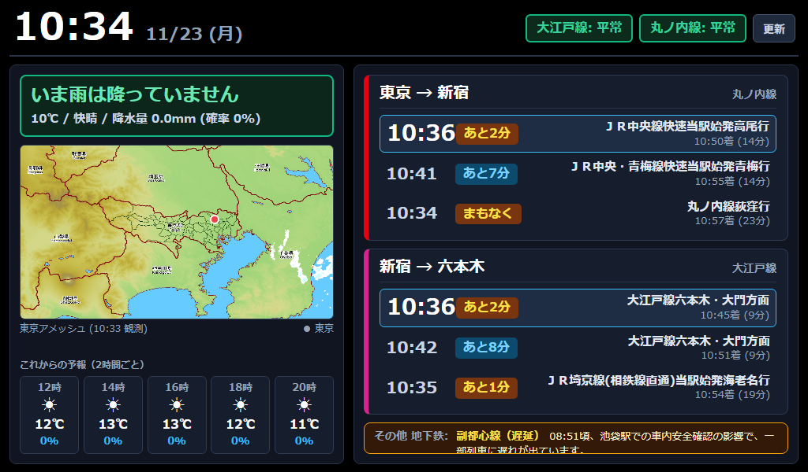

# KindleImaDouDisplay

Kindle Fire 7（第7世代 / 1024×600 / RAM 1GB / Fire OS 5）向けの**超軽量・高コントラスト常時表示サイネージ**です。  
「いま雨が降っているか（東京アメッシュ）」「これからの天気予報」「最寄り駅の次の発車」「地下鉄の運行・遅延詳細」を 1 画面に収めます。



---

## 主な機能

- **今の降水判定 & 東京アメッシュ雨雲レーダー**
  - Open-Meteo API による現在の降水判定（「いま雨は降っていません / いま雨が降っています」）と気温・降水確率
  - 東京アメッシュ（東京都下水道局）の地図＋1分刻みの最新雨雲透過画像をサーバー経由でプロキシ表示（対象地点の赤ピン付き）
- **これからの天気予報**
  - 2時間ごと × 5枠（時刻・天気・気温・降水確率）
- **指定駅の次発案内**
  - 環境変数で指定した任意の区間（複数可）の直近3本の発車時刻・「あと〇分」・行先・到着時刻を 1 分ごとに更新
- **地下鉄 運行情報（東京メトロ・都営地下鉄）**
  - ヘッダーに主要路線のステータスを常時表示
  - 遅延・運転見合わせがある路線は、下段に詳細理由（方向・発生時刻・影響範囲）を強調表示
- **Kindle Fire 7th gen 最適化**
  - 外部フォント・地図ライブラリ・Canvas・CSS アニメーション不使用
  - 古い Android 5.1 WebView でも安定動作する ES5 + `XMLHttpRequest` で実装

---

## 環境変数

自宅の駅名や座標はリポジトリに含めず、環境変数で注入します。

| 環境変数 | デフォルト | 説明 |
|---|---|---|
| `PORT` | `3000` | 待受ポート |
| `TZ` | `Asia/Tokyo` | タイムゾーン |
| `LOCATION_LABEL` | `東京` | アメッシュ下に表示する地点名 |
| `WEATHER_LAT` | `35.6812` | 天気取得用の緯度 |
| `WEATHER_LON` | `139.7671` | 天気取得用の経度 |
| `AMESH_PIN_X` | `62` | 東京アメッシュ広域地図上のピン X 座標（`%`） |
| `AMESH_PIN_Y` | `43` | 東京アメッシュ広域地図上のピン Y 座標（`%`） |
| `PRIMARY_LINES` | `丸ノ内線,大江戸線` | ヘッダーに常時表示する路線名（カンマ区切り） |
| `DEPARTURE_ROUTES_JSON` | `[{"id":"route1",...}]` | 次発案内を表示する駅ルート配列（JSON） |

### `DEPARTURE_ROUTES_JSON` の書式例

```json
[
  {
    "id": "route1",
    "from": "東京",
    "to": "新宿",
    "title": "東京 → 新宿",
    "line": "丸ノ内線",
    "color": "#e60012"
  },
  {
    "id": "route2",
    "from": "新宿",
    "to": "六本木",
    "title": "新宿 → 六本木",
    "line": "大江戸線",
    "color": "#d6248e"
  }
]
```

---

## デプロイ方法

### 1. TrueNAS SCALE 25.04+ / Docker Compose（Watchtower 自動更新付き）

`compose.yaml` をコピーして環境変数を自分用に書き換え、TrueNAS UI の **Apps → Discover Apps → ⋮ → Install via YAML** に貼り付けます。

- `main` へ push すると GitHub Actions（`.github/workflows/docker.yml`）が `ghcr.io/mmurasawa/kindleimadoudisplay:latest`（`linux/amd64`, `linux/arm64`）を自動ビルド＆プッシュします。
- 同梱の **Watchtower** が `com.centurylinklabs.watchtower.enable=true` ラベル付きの `imadou` コンテナだけを 5 分おきにチェックし、自動更新します。

```bash
docker compose up -d
```

### 2. Kubernetes / Helm Chart

`charts/imadou/values.yaml` をベースに `values.local.yaml`（`.gitignore` 対象）を作成してデプロイします。Tailscale Kubernetes Operator の `LoadBalancer` / `Ingress` にも対応しています。

```bash
helm upgrade --install imadou ./charts/imadou -f ./charts/imadou/values.local.yaml
```

### 3. ローカル PC（Node.js）

```bash
npm install
npm start
```

Windows の場合は `start.bat` のダブルクリックでも起動できます。

---

## Kindle Fire 7 での表示おすすめ設定

- **ブラウザ**: **Fully Kiosk Browser**（Fire OS 用 APK）
- **接続先**: 自宅 LAN 内の HTTP URL（例：`http://<TrueNASのLAN IP>:3000`）  
  ※ 古い Fire OS 5 はルート証明書が古いため、自宅固定なら LAN 内 HTTP 直結が最も安定します。
- **推奨設定**:
  - `Keep Screen On`: ON
  - `Launch on Boot`: ON
  - `Auto Reload on Network Reconnect`: ON
  - `Fullscreen / Hide Status & Navigation Bar`: ON
  - 輝度 40〜60% ＆ 夜間画面オフタイマー（バッテリー劣化防止）
